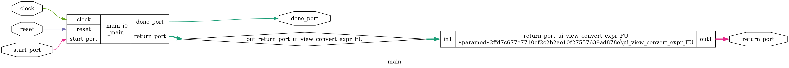

# agentic-fpga

**An agentic HLS pipeline that turns trading logic in C into verified FPGA circuits — no RTL expertise required.**

**让 AI 把 C 语言交易逻辑自动编译成可验证的 FPGA 电路 —— 无需任何硬件设计经验。**

[]() [](LICENSE) []() []()

---

## English

### Why

LLM-generated RTL fails mainly because models lack RTL-specific knowledge (documented pass rates ~72% for GPT-4-class models). This project sidesteps that failure source entirely: **the LLM writes plain C, and open-source high-level synthesis ([Bambu](https://panda.dei.polimi.it)) compiles it into RTL**, which is then verified by simulation against a NumPy reference model.

The niche is empty: the LLM-verification school (AutoChip, RTLFixer, ...) all generate Verilog directly; the HLS school uses hand-written C with no agent in the loop. Nobody connects agentic iteration with HLS — for trading workloads, where every strategy / exchange protocol / latency budget is a *custom* design requirement, and manual RTL engineering is the bottleneck.

**Chips are a customization business. This repo builds the factory, not one chip.**

### Status — v0.0.1 (environment milestone, verified)

- [x] WSL2 + Ubuntu 26.04 toolchain: Bambu 2024.10 + Verilator 5.032 + cocotb 2.1.0 + Yosys 0.52, all open-source, zero license
- [x] Official example (CHStone/adpcm) full flow: **C → RTL (9,583 FFs) → Verilator co-simulation → PASS** (`testbench returned: 0`)
- [x] Generated circuits inspected at gate level with Yosys (see below)
- [x] 2026-10-28: **ITCH 5.0 golden reference model** (`itch5/`) — zero-dep parser + byte-exact builders + shadow order book + real-sample stats CLI; 12/12 tests, 700-case fuzz clean. Foundation for the 0.2.x feed-handler phase ([ROADMAP v0.3](docs/ROADMAP-v0.3.md))

### What a generated circuit looks like

`int kernel(int a, int b) { return a*b + 42; }` — synthesized by Bambu, flattened and rendered by Yosys:

| Top-level skeleton | Functional units (multiplier, registers, FSM) |
|---|---|
|  |  |

The adpcm circuit is 45k lines of Verilog / 3,266 gate-level cells for the tiny smoke kernel.

### ITCH 5.0 golden reference model (ready now)

Every hardware block gets a software twin it must match. `itch5/` is the twin for the upcoming FPGA feed handler & order book:

```bash
python tests/test_itch5.py              # 12 tests, zero dependencies
python -m itch5.stats <sample.itch>     # message histogram of a real NASDAQ sample file
```

Messages are parsed with absolute byte offsets, so the FPGA parser can be diffed against this model message by message — the same cross-check discipline as econometrics (R↔Python), applied software↔hardware.

### Quick start (0.0.1 environment, ~30 min)

> Requires Windows 10/11 with WSL2 enabled, or any Linux box (tested on Ubuntu 26.04; the fix script handles Ubuntu 24.04+ GCC layout).

```bash
# 1. Inside WSL/Ubuntu — install base deps
sudo apt-get install -y build-essential python3-pip g++-multilib wget git iverilog verilator

# 2. Download the official Bambu AppImage (~1.3 GB, EU server)
mkdir -p ~/tools && cd ~/tools
wget -c https://release.bambuhls.eu/bambu-latest.AppImage
chmod +x bambu-latest.AppImage && ./bambu-latest.AppImage --appimage-extract

# 3. Apply the path fixes (see "Gotchas solved" below)
git clone https://github.com/ljftwq-dev/agentic-fpga.git
sudo bash agentic-fpga/setup/bambu_appimage_fix.sh

# 4. Add to PATH
echo 'export PATH=$HOME/tools/squashfs-root/usr/bin:$PATH' >> ~/.bashrc && source ~/.bashrc

# 5. Verify with the official CHStone/adpcm example
git clone --depth 1 https://github.com/ferrandi/CHStone.git
mkdir adpcm && cp CHStone/adpcm/adpcm.c adpcm/ && cd adpcm
bambu adpcm.c --simulate -fwhole-program -fno-delete-null-pointer-checks
# expect: "Sim: Testbench returned: 0"
```

### Gotchas solved (2026-09, worth knowing even outside this project)

The official `bambu.polimi.it` apt repository **no longer resolves (NXDOMAIN)** — the AppImage is now the practical install path, but it hardcodes `/usr` paths. Six fixes are needed, all scripted in [`setup/bambu_appimage_fix.sh`](setup/bambu_appimage_fix.sh):

1. `/usr/share/panda` — technology libraries
2. `/usr/lib/panda` — bambu frontend libraries
3. `/usr/bin/clang-16` — must point at the **bundled** clang, not the vanilla LLVM release also shipped in the image
4. `libtinfo.so.5` — bundled copy beats the libtinfo6→5 symlink hack
5. `/usr/gcc_plugins` — clang plugins; without them, `-panda-*` options are rejected
6. `libbdd.so.0` — the only external dep of the plugins

Plus three Ubuntu 24.04+/GCC-15 era issues for the simulation flow: GCC platform-header layout (`bits/c++config.h`), 64-bit and 32-bit `-lstdc++` dev links (the testbench links with `-m32`).

### Roadmap (see [docs/ROADMAP-v0.3.md](docs/ROADMAP-v0.3.md) — 2026-10-28 "real trading infrastructure" redirect)

| Version | Scope | Status |
|---|---|---|
| 0.0.1 | Toolchain + official example simulation PASS | ✅ done |
| 0.1.0 | EMA+RSI streaming kernel; agentic loop (GLM writes C → Bambu → co-simulation vs NumPy → iterate, ≤10 rounds); CPU vs RTL benchmark | 🚧 next (semester) |
| 0.2.x | ITCH 5.0 feed handler (golden model ✅ `itch5/` → FPGA parser next) + order book matching kernel (fixed-point) | winter |
| 0.3.x | Host bridge into the live paper executor — tick-to-trade demo with measured end-to-end latency | winter–spring |
| 1.0.0 | tradeable tool — the open-source everyman's version of "algorithms straight into logic gates" | north star |

### Credits

- [Bambu / PandA](https://panda.dei.polimi.it) — HLS framework, Politecnico di Milano (GPLv3)
- [CHStone](https://github.com/ferrandi/CHStone) — benchmark suite
- [Yosys](https://yosyshq.net/yosys/) / [Verilator](https://www.verilator.org) / [cocotb](https://www.cocotb.org)

---

## 中文说明

### 为什么做这个

LLM 直接写 Verilog 的失败主因是"缺 RTL 专业知识"（GPT-4 级模型通过率仅约 72%，学术实证）。本项目绕开这个失败源：**让 LLM 写普通 C，开源高层综合器 Bambu 负责把 C 编译成电路**，再用仿真对拍验证。

目前"LLM+验证闭环"派（AutoChip、RTLFixer 等）全部直接生成 Verilog，"HLS 应用"派全是人工写 C 没有智能体参与——两者交集为空白。而交易场景里每个策略、每个交易所协议、每个延迟预算都是**个性化设计需求**，人工 RTL 工程是瓶颈：

**芯片是个性化定制的生意，这个仓库造的是"电路印刷厂"，不是某一颗电路。**

### 当前状态 —— v0.0.1（环境里程碑，已验收）

- ✅ WSL2 + Ubuntu 26.04 全开源工具链：Bambu 2024.10 + Verilator 5.032 + cocotb 2.1.0 + Yosys 0.52，零 license 费用
- ✅ 官方示例 CHStone/adpcm 全流程：**C → RTL（9583 个触发器）→ Verilator 协同仿真 → PASS**（`Testbench returned: 0`）
- ✅ 用 Yosys 对生成电路做了门级透视（见上方电路图）
- ✅ 2026-10-28：**ITCH 5.0 黄金参考模型**（`itch5/`）——零依赖解析器 + 字节级精确构造器 + 影子订单簿 + 真实样本统计 CLI；12/12 测试通过，700 例 fuzz 全干净。0.2.x 行情解析阶段的基石（见 [ROADMAP v0.3](docs/ROADMAP-v0.3.md)）

### ITCH 5.0 黄金参考模型（已就绪）

每个硬件模块都必须有一个与之对拍的软件孪生——`itch5/` 就是未来 FPGA 行情解析器与订单簿内核的孪生：

```bash
python tests/test_itch5.py              # 12 个测试，零依赖
python -m itch5.stats <sample.itch>     # 真实 NASDAQ 样本文件的消息直方图
```

所有消息带绝对字节偏移解析，FPGA 解析器可以逐消息与本模型 diff——把计量经济学里 R↔Python 对拍的纪律，搬到软件↔硬件。

### 快速开始

见上方英文版 Quick Start（命令通用），修复脚本在 `setup/bambu_appimage_fix.sh`。

### 踩坑实录（2026-09）

官方 apt 源域名已全球失效（NXDOMAIN），AppImage 成为实际安装途径，但它写死了 `/usr` 绝对路径，需要六处软链修复（脚本已固化）；另有三处 Ubuntu 24.04+/GCC15 时代的头文件布局与 32 位链接问题。全部修复可一键重放。

### 路线图（详见 [docs/ROADMAP-v0.3.md](docs/ROADMAP-v0.3.md) —— 2026-10-28"真交易基础设施"定调）

| 版本 | 内容 | 状态 |
|---|---|---|
| 0.0.1 | 工具链 + 官方示例仿真 PASS | ✅ 已完成 |
| 0.1.0 | EMA+RSI 流式内核；agentic 闭环（GLM 写 C → Bambu 综合 → NumPy 对拍 → 迭代，≤10 轮熔断）；CPU vs 电路对比 | 🚧 下一步（本学期） |
| 0.2.x | ITCH 5.0 行情解析器（黄金模型 ✅ `itch5/`，下一步 FPGA 侧）+ 订单簿撮合内核（定点化） | 寒假 |
| 0.3.x | 主机桥——接进正在实盘跑的模拟盘执行器，tick-to-trade 延迟实测 | 寒假—开春 |
| 1.0.0 | 可交易工具——"算法直接进逻辑门"的开源平民版 | 终极目标 |

完整规格书见 [docs/SPEC-v0.2.md](docs/SPEC-v0.2.md)（英文/中文对照表格）。

## License

MIT — see [LICENSE](LICENSE). Generated RTL inherits Bambu's GPLv3/LGPLv3 component licensing where applicable.
